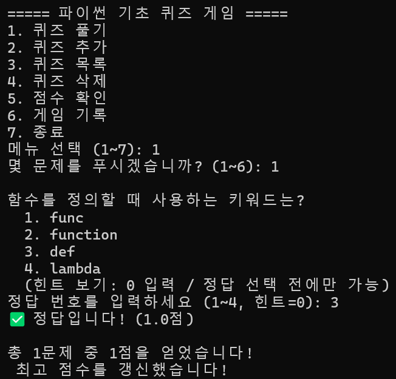
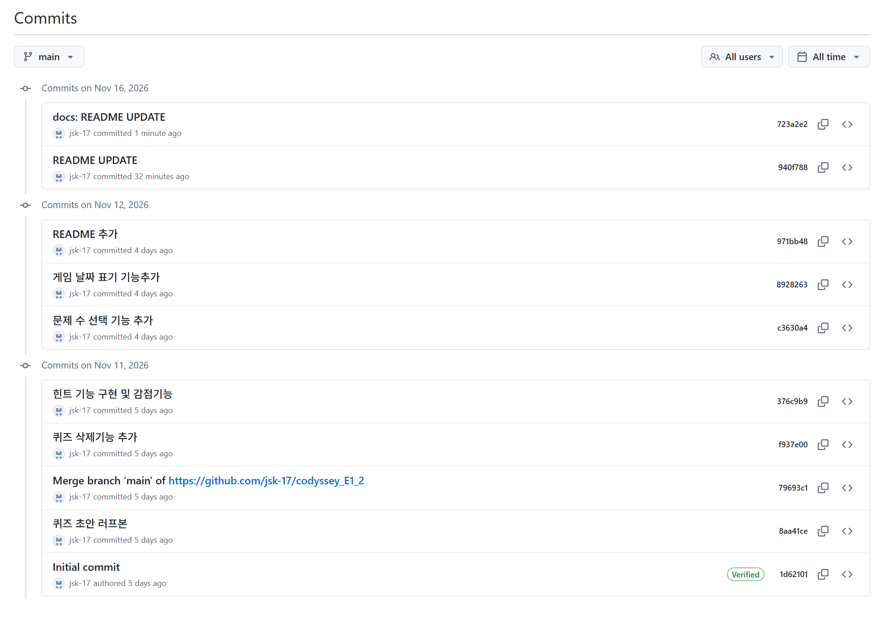
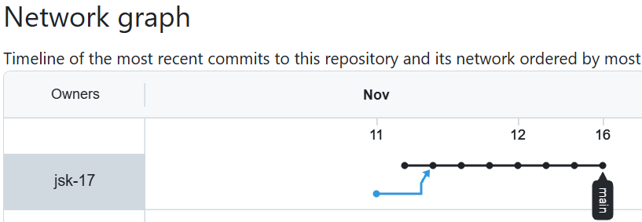
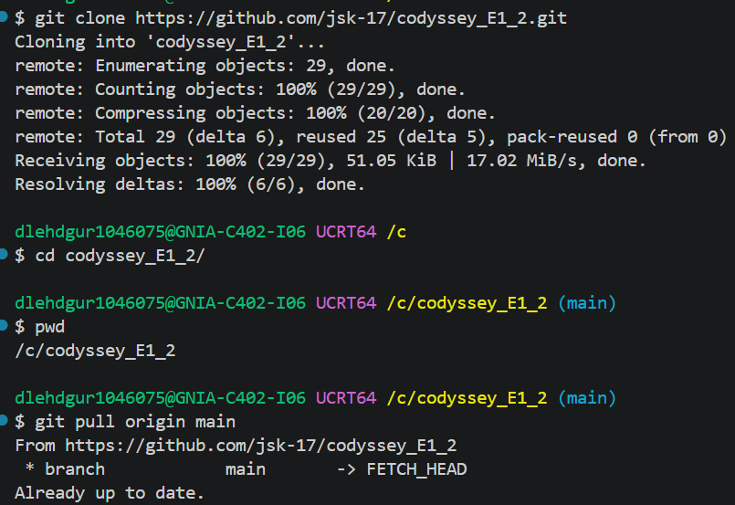

# codyssey_E1_2
파이썬 기초 퀴즈 게임 
Python 기초 개념을 4지선다 퀴즈로 학습할 수 있는 콘솔(CLI) 프로그램입니다.
문제 풀이, 문제 관리(추가·삭제), 점수·기록 저장 기능을 제공합니다.

주요 기능
기능	설명
퀴즈 풀기	풀고 싶은 문제 수를 선택해 랜덤으로 출제. 힌트 사용 가능
힌트 시스템	정답 입력 전 0을 누르면 힌트 표시 (단, 점수가 1점 → 0.5점으로 감점)
퀴즈 추가	문제·선택지 4개·정답·힌트를 직접 등록
퀴즈 목록	등록된 전체 문제 조회
퀴즈 삭제	번호를 선택해 문제 삭제 (삭제 전 확인)
점수 확인	현재까지의 최고 점수 조회
게임 기록	모든 게임의 날짜·시간, 푼 문제 수, 점수 기록 조회
자동 저장	모든 데이터를 state.json에 저장

실행 방법
```bash
python Quiz.py
```
실행하면 메뉴가 나타납니다.
```code
===== 파이썬 기초 퀴즈 게임 =====
1. 퀴즈 풀기
2. 퀴즈 추가
3. 퀴즈 목록
4. 퀴즈 삭제
5. 점수 확인
6. 게임 기록
7. 종료
```
원하는 메뉴 번호를 입력하면 됩니다.

사용법
1. 퀴즈 풀기
메뉴에서 1 입력
풀 문제 수 선택 (예: 전체 6문제 중 3문제)
각 문제마다 1~4 중 정답 선택
정답 선택 전 0을 누르면 힌트 확인 (힌트 사용 시 해당 문제 0.5점)
마지막에 총점이 표시되고, 기록이 자동 저장됨
2. 점수 규칙
힌트 없이 정답: 1점
힌트 보고 정답: 0.5점
오답: 0점

파일 구조
```
프로젝트 폴더/
├── Quiz.py          # 메인 프로그램
└── state.json       # 데이터 저장 파일 (자동 생성)
```
state.json 내부 구조
```json
{
  "quizzes": [
    {
      "question": "문제 내용",
      "choices": ["선택지1", "선택지2", "선택지3", "선택지4"],
      "answer": 2,
      "hint": "힌트 내용"
    }
  ],
  "best_score": 6,
  "history": [
    {
      "datetime": "2026-11-12 06:38:09",
      "count": 6,
      "score": 6
    }
  ]
}
```

quizzes: 등록된 전체 퀴즈
best_score: 최고 점수
history: 게임별 기록(날짜/시간, 푼 문제 수, 점수)
state.json이 없거나 손상된 경우, 프로그램이 기본 퀴즈 데이터로 자동 복구합니다.

코드 구성
클래스 / 함수	역할
Quiz	개별 퀴즈 1개를 표현 (문제, 선택지, 정답, 힌트)
get_default_quizzes()	기본 제공 퀴즈 데이터 반환
QuizGame	게임 전체 관리 (메뉴, 입출력, 파일 저장/불러오기)
특징
예외 처리: 숫자 입력 시 빈 값·문자·범위 초과를 걸러내고 재입력 유도
하위 호환: 기존 state.json에 history 필드가 없어도 오류 없이 동작
안전한 종료: Ctrl+C 등으로 중단해도 데이터를 저장 후 종료
확장 가능성 💡
정답률(%) 표시: 기록에 score/count×100을 추가해 문제 수가 달라도 공정하게 비교
기록 개수 제한: 최근 N개만 보관/표시
난이도·카테고리: 퀴즈에 난이도 필드를 추가해 분류 출제

## 실행 증빙

실제 실행 화면과 로그입니다.




실행 로그 예시:
```text
$ python quiz.py

===== 파이썬 기초 퀴즈 게임 =====
1. 퀴즈 풀기
2. 퀴즈 추가
3. 퀴즈 목록
4. 퀴즈 삭제
5. 점수 확인
6. 게임 기록
7. 종료
메뉴 선택 (1~7): 1
몇 문제를 푸시겠습니까? (1~6): 1

문자열 타입을 나타내는 것은?
  1. int
  2. str
  3. bool
  4. float
  (힌트 보기: 0 입력 / 정답 선택 전에만 가능)
정답 번호를 입력하세요 (1~4, 힌트=0): 2
✅ 정답입니다! (1.0점)

총 1문제 중 1점을 얻었습니다!
 최고 점수를 갱신했습니다!
```

---

## 원격 저장소 및 커밋 이력


커밋 히스토리 (`git log --oneline`):
```text
$ git log --oneline
$ git log --oneline
5cfd34d (HEAD -> main, origin/main, origin/HEAD) docs: finalupdate
723a2e2 docs: README UPDATE
940f788 README UPDATE
971bb48 README 추가
8928263 게임 날짜 표기 기능추가
c3630a4 문제 수 선택 기능 추가
376c9b9 힌트 기능 구현 및 감점기능
f937e00 퀴즈 삭제기능 추가
79693c1 Merge branch 'main' of https://github.com/jsk-17/codyssey_E1_2
8aa41ce 퀴즈 초안 러프본
```



---

## 브랜치 및 병합 이력 (평가 항목 #6)

브랜치 전략과 병합 그래프입니다.

```text
$ git log --oneline --graph --all
* 5cfd34d (HEAD -> main, origin/main, origin/HEAD) docs: finalupdate
* 723a2e2 docs: README UPDATE
* 940f788 README UPDATE
* 971bb48 README 추가
* 8928263 게임 날짜 표기 기능추가
* c3630a4 문제 수 선택 기능 추가
* 376c9b9 힌트 기능 구현 및 감점기능
* f937e00 퀴즈 삭제기능 추가
*   79693c1 Merge branch 'main' of https://github.com/jsk-17/codyssey_E1_2
|\  
| * 1d62101 Initial commit
```



---

## Clone / Pull 실습

```bash
# 저장소 복제
git clone https://github.com/jsk-17/codyssey_E1_2.git
cd codyssey_E1_2

# 최신 변경사항 가져오기
git pull origin main
From https://github.com/jsk-17/codyssey_E1_2
 * branch            main       -> FETCH_HEAD
Already up to date.
```



---

## 커밋 규칙

### 커밋 단위
- 하나의 논리적 변경 = 하나의 커밋 (기능 추가, 버그 수정, 리팩터링을 섞지 않음)
- 작동하는 상태 단위로 커밋

### 커밋 메시지 템플릿
```text
<타입>: <요약 (50자 이내)>

<본문: 변경 이유와 내용 (선택)>
```

| 타입 | 의미 |
|------|------|
| feat | 새 기능 추가 |
| fix | 버그 수정 |
| docs | 문서 수정 |
| refactor | 기능 변경 없는 코드 개선 |
| test | 테스트 추가/수정 |
| chore | 설정·기타 작업 |

예시: `feat: 힌트 사용 시 0.5점 감점 로직 추가`

---

## 대량 데이터 성능 분석

퀴즈 수 N이 커질 때(예: N ≥ 1000)의 영향 분석입니다.

| 작업 | 시간 복잡도 | 비고 |
|------|------------|------|
| 전체 로드 (json.load) | O(N) | 전체를 메모리에 적재 |
| 메모리 사용 | O(N) | 모든 퀴즈 객체를 리스트로 보관 |
| 퀴즈 목록 출력 | O(N) | 전체 순회 |
| 랜덤 출제 | O(k) | k = 출제 문제 수 |
| 퀴즈 삭제 (인덱스) | O(N) | 리스트 재구성 |
| 저장 (json.dump) | O(N) | 전체 직렬화 |

**병목**: 매 저장 시 전체 state.json을 다시 쓰므로 N이 커지면 I/O 비용 증가.

**개선 방안**
- 전체 JSON 대신 SQLite 등 DB로 전환해 인덱스 기반 조회·삭제 (O(log N))
- 삭제 시 리스트 대신 dict(id→quiz) 사용으로 O(1) 삭제
- 변경분만 저장하는 증분 저장 방식 도입

---

## 백업 및 복구 절차

기존의 "손상 시 기본 데이터로 복구"에 더해 **백업 기반 복구**를 추가합니다.

- 저장 시마다 직전 상태를 `state.json.bak`으로 보관
- 로드 실패 시 순서: `state.json` → `state.json.bak` → 기본 퀴즈 데이터

구현 예시:
```python
import json, os, shutil

def save_state(self):
    # 기존 파일을 백업으로 복사
    if os.path.exists('state.json'):
        shutil.copy('state.json', 'state.json.bak')  # 직전 버전 보존
    with open('state.json', 'w', encoding='utf-8') as f:
        json.dump(self.to_dict(), f, ensure_ascii=False, indent=2)

def load_state(self):
    for path in ('state.json', 'state.json.bak'):   # 본파일 → 백업 순으로 시도
        try:
            with open(path, encoding='utf-8') as f:
                return json.load(f)
        except (json.JSONDecodeError, KeyError, OSError):
            continue
    return get_default_quizzes()  # 모두 실패 시 기본 데이터
```

---

## 요구 변경 시 영향 범위

요구사항이 바뀔 때 수정해야 할 대상을 정리합니다.

| 변경 요구 | 영향 받는 부분 |
|-----------|---------------|
| 점수 규칙 변경 (예: 힌트 감점량) | `QuizGame`의 점수 계산 로직 |
| 선택지 개수 변경 (4지→5지) | `Quiz` 모델, 입력 검증, 퀴즈 추가 메뉴 |
| 저장 형식 변경 (JSON→DB) | `save_state`/`load_state`, state.json 구조 |
| 기록 필드 추가 (정답률 등) | `history` 구조, 기록 조회 메뉴 |
| 난이도/카테고리 도입 | `Quiz` 모델, 출제 로직, 추가 메뉴 |